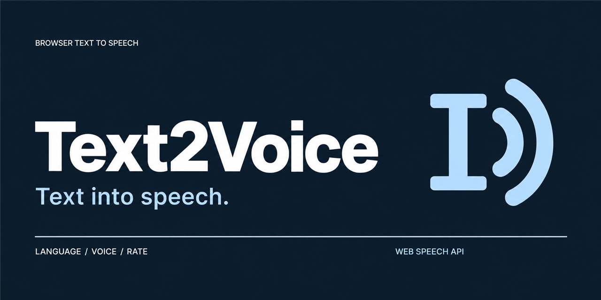

# Text2Voice

Text2Voice is a React and TypeScript browser app that reads typed text aloud through the Web Speech API. It filters the voices provided by the browser and operating system for selected English, Japanese, Korean, and Chinese locales, with controls for voice, volume, speaking rate, and color theme.



## Features

- Reads entered text with `SpeechSynthesisUtterance`
- Lists available voices for `en-US`, `ja-JP`, `ko-KR`, `zh-TW`, `zh-CN`, and `zh-HK`
- Selects a voice within the chosen locale
- Adjusts speech volume and rate
- Cancels the current utterance before starting another
- Switches between light and dark themes
- Runs entirely in the browser without a project-specific speech model or application backend

## Demo

[](https://sky9154.com/github/Text2Voice/)

## Requirements

- Node.js 12.13.0 or later
- Yarn Classic
- A browser that supports the Web Speech API
- At least one installed or browser-provided voice matching a supported locale

The minimum Node.js version matches the `>=12.13.0` engine declared by the locked Webpack Dev Server 4.11.1 dependency. Voice availability and speech quality depend on the browser, operating system, and installed voice packages.

## Run locally

Run the following commands from the repository root:

```bash
yarn install
yarn dev
```

Open the development URL printed by Webpack Dev Server.

## Project commands

| Command | Purpose |
| --- | --- |
| `yarn dev` | Start Webpack Dev Server |
| `yarn build` | Create a production-mode bundle in `build/` |
| `yarn prettier` | Format files under `src/` |
| `yarn deploy` | Build the application and publish `build/` through `gh-pages` |

## How speech is produced

The application calls `window.speechSynthesis.getVoices()` when it starts. If the browser has not loaded its voice list yet, it waits for the `voiceschanged` event.

Before playback, the app creates a `SpeechSynthesisUtterance`, assigns the entered text, selected voice, volume, and rate, then passes it to `speechSynthesis.speak()`. Any active utterance is cancelled first.

## License

The project is distributed under the [MIT License](./LICENSE). Copyright © 2022 oF.
